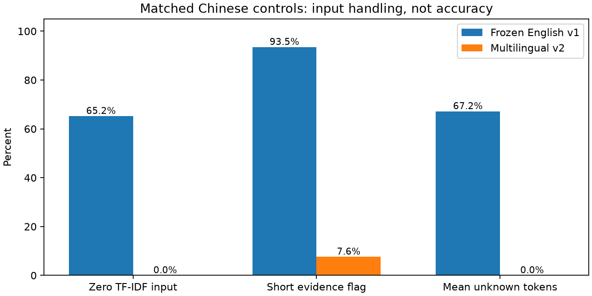
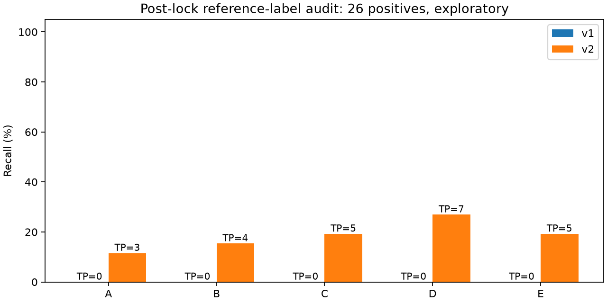
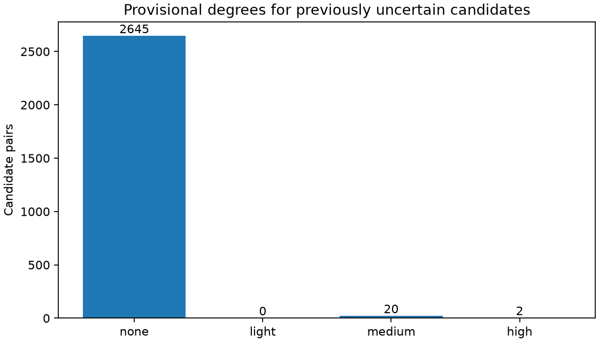

# 多语言重复内容识别与程度复核

## 当前结论

已完成独立的多语言版本：冻结多语言编码器、中文字符词面表示、否定与数字/型号差异特征，以及重新训练的C/E逻辑回归。新版本可以统一读取中文、英文和混杂正文。输入覆盖问题有明显改善，但当前没有方法通过预设选型条件，不能自动据此降权商品评分。

原英语模型、原封存测试和原评分交接包没有修改。新代码和模型另存版本，程度规则与分类器分开版本化。

## 数据来源与限制

原英语样本仍为90,750条/1,000个商品。本次新增中文辅助来源：
[OpenModels/Chinese-Herbal-Medicine-Sentiment](https://huggingface.co/datasets/OpenModels/Chinese-Herbal-Medicine-Sentiment)，固定提交6b2b55d97dd3b99b917aa637da501357f7b8adc0。通过datasets有限流式读取20,000行，每商品最多60条；保留11,663条/254商品，排除平台占位正文365条、因商品上限未保留7,972条。这两个原因不等同于数据质量异常。

数据卡声称来源为中国电商抓取并声明MIT；原始平台和采集链路未独立验证。正文保留本地，不在公开交接包重新发布。辅助领域与手机配件不同，不能将其效果解释为手机配件中文效果或医学主张真实性。未使用情感/星级标签生成重复标签。

中文样本SHA-256：de7d2bf3566a8bd8836dc08c0371cf6d28d58d2134aebcca8928301acf9bec2b。各清单、标签与复核记录均保存在本地data/multilingual_v2/。跨集合相同规范化文本移入公共模板池；完全相同来源记录的额外副本不参加监督候选，但不同用户相同措辞仍保留。公共模板513行、同商品措辞额外副本113行、完全相同来源额外记录12行；这些口径可能重叠，不能相加。

### 原参考仓库的数据入口

[livingbody/Commodity_Review_Sentiment_Predictions](https://github.com/livingbody/Commodity_Review_Sentiment_Predictions)的README给出平台入口和解压本地文件的命令。pip安装PaddleNLP，tar解压已有的data/data96333/商品评论情感预测.gz；它们不下载这个压缩包。

原竞赛[数据记录](https://www.heywhale.com/mw-org/series_5ffbf4d2a96f9e0036c2bffb/dataset/60c229a28402f80018f8cb69)要求注册并加入组织；[公开元数据](https://www.heywhale.com/api/datasets/60c229a28402f80018f8cb69)返回Private=true、allowToUse=false、orgEnableDownload=false，无公开文件树。本次未取得原压缩包。

[ModelScope DAMO_NLP/jd](https://modelscope.cn/datasets/DAMO_NLP/jd)的数据卡引用同一竞赛，可读取其公开处理文件；实读字段为sentence,label,dataset，没有商品ID。因此它能补充正文诊断，不能冒充同商品评论对来源。本次监督训练使用上面单独标识的辅助语料。

## 划分、标签和训练

中文按商品划分，seed=42；盲标任务为训练300、验证150、测试150对，覆盖词面/语义近邻、随机对和短评。此前6,000对英语任务保持原版本，总研究候选6,600对。候选采样会富集相似内容，样本重复比例不是自然总体重复率。

标签为辅助逐对判断，未经独立人类金标准验证。训练和验证在拟合前完成内容复核，修正正文与理由错位和仅凭同情感/同主题判重复的问题；原草稿和逐条修改原因均留本地。

中文训练复核后：完全重复8、近似48、非重复139、不确定105。中文验证：完全重复15、近似13、非重复83、不确定39。训练只使用确定标签：英语2,258对、中文195对，共2,453对。按来源语料总权重平衡；来源、语言、商品、用户、评分、时间和标签来源都不是输入特征。不确定训练项不强行当负例。

TF-IDF为char 2—4 gram、min_df=2、最多100,000特征，只用隔离后的训练正文拟合。中文长度按汉字与拉丁词片段的证据单位计数，不称中文词数；generic_phrase与short_evidence是不同特征。en/zh/mixed是文字脚本启发式分组，包含USB/PD等产品术语的中文可能归mixed；它不是严格语言识别，不用于路由不同模型。

语义模型为[sentence-transformers/paraphrase-multilingual-MiniLM-L12-v2](https://huggingface.co/sentence-transformers/paraphrase-multilingual-MiniLM-L12-v2)，固定提交e8f8c211226b894fcb81acc59f3b34ba3efd5f42，384维、参数冻结。官方128 token上限通过126 token正文窗口、24 token重叠覆盖长评，覆盖权重平均后L2标准化；没有直接丢弃尾部，但聚合可能弱化局部事实差异。

实际编码8,109个不同输入，长输入828条，设备cuda，batch=64，编码35.67秒，峰值显存590.1MiB。初次下载时间未单独留计时记录；本次记录的是已缓存模型加载/编码。缓存绑定文本顺序、模型提交、窗口配置和实现SHA，缓存文件另有SHA校验。

C/E使用标准化与L2逻辑回归，C比较0.1/1/10，最终均为0.1；模型选择只用验证集。验证95%精确率下界、至少30个候选正例，以及三个脚本分组的样本条件均未通过。固定探索阈值A=1、B/D=0.8、C/E=0.5；没有根据测试改阈值。

## 中文参考评价与标签审计

首次模型锁后读取150对封存中文标签：原始参考标签为8完全、68近似、56非重复、18不确定。随后的正文质量审计发现部分近似标签过宽、理由提到另一评论的细节。原封存标签/结果仍保留；另存审计后的参考版本，不重训模型、不重新选择阈值。

审计后的150对来自33商品：完全8、近似18、非重复88、不确定36；二分类有效114对、其中26个正例。以下是**后验标签质量复核的探索比较**，不是首次封存人类金标准测试。首次结果与修改清单可在本地对应CSV和两个receipt中核对。标签质量仍是主要限制。

### 原阈值信号与复核门槛分别查看

不附加通用/短评排除条件的原阈值信号如下，不能称自动决策：

| version | method | tp | fp | fn | precision | recall | precision_lower |
| --- | --- | --- | --- | --- | --- | --- | --- |
| v1 | A | 8 | 0 | 18 | 100.0% | 30.8% | 80.0% |
| v1 | B | 4 | 1 | 22 | 80.0% | 15.4% | 80.0% |
| v1 | C | 4 | 1 | 22 | 80.0% | 15.4% | 80.0% |
| v1 | D | 19 | 26 | 7 | 42.2% | 73.1% | 33.9% |
| v1 | E | 5 | 1 | 21 | 83.3% | 19.2% | 83.3% |
| v2 | A | 8 | 0 | 18 | 100.0% | 30.8% | 80.0% |
| v2 | B | 12 | 2 | 14 | 85.7% | 46.2% | 75.0% |
| v2 | C | 14 | 2 | 12 | 87.5% | 53.8% | 58.3% |
| v2 | D | 24 | 38 | 2 | 38.7% | 92.3% | 28.6% |
| v2 | E | 14 | 3 | 12 | 82.4% | 53.8% | 53.8% |

C从4个确定正例/1误信号增加为14个/2，召回从15.4%到53.8%；E也检出14个但误信号3个，语义特征没有超过C。D召回从73.1%到92.3%，误信号同时从26个增至38个，不能单看召回宣称效果更好。

当前generic_phrase详情词表偏手机配件，对辅助中文领域的部分长评过于保守。逐行追踪可见，5个规范化精确匹配正例，以及17个D原阈值正信号的确定正例，被这一标记挡出候选；这说明候选召回限制既有判别器因素，也有排除规则的覆盖问题。该标记是启发式，不代表已确认正文只含泛评。程度层单独核对事实，不沿用这一标记直接判非重复。此问题是在锁后参考审计中发现，本轮保留锁和首次结果；后续规则改版需要新的验证与独立测试，不能把同一测试反复用于优化后再当首次评价。

附加既定门槛后的候选信号为：

| version | method | n | tp | fp | fn | tn | precision_display | recall_display | precision_lower_display |
| --- | --- | --- | --- | --- | --- | --- | --- | --- | --- |
| v1 | A | 114 | 0 | 0 | 26 | 88 | 未定义（无预测正例） | 0.0% | 0.0% |
| v1 | B | 114 | 0 | 0 | 26 | 88 | 未定义（无预测正例） | 0.0% | 0.0% |
| v1 | C | 114 | 0 | 0 | 26 | 88 | 未定义（无预测正例） | 0.0% | 0.0% |
| v1 | D | 114 | 0 | 11 | 26 | 77 | 0.0% | 0.0% | 0.0% |
| v1 | E | 114 | 0 | 0 | 26 | 88 | 未定义（无预测正例） | 0.0% | 0.0% |
| v2 | A | 114 | 3 | 0 | 23 | 88 | 100.0% | 11.5% | 60.0% |
| v2 | B | 114 | 4 | 0 | 22 | 88 | 100.0% | 15.4% | 66.7% |
| v2 | C | 114 | 5 | 0 | 21 | 88 | 100.0% | 19.2% | 71.4% |
| v2 | D | 114 | 7 | 1 | 19 | 87 | 87.5% | 26.9% | 53.8% |
| v2 | E | 114 | 5 | 0 | 21 | 88 | 100.0% | 19.2% | 71.4% |

无预测正例时精确率未定义，不能写成零精确率证明模型错误；有预测正例时仍须看数量。例如C/E只有5个确定正例、0个确定误判，另有2个不确定候选，保守精确率下界71.4%，远不足以证明95%自动识别。

以商品为单位1,000次bootstrap、seed=42，置信区间与有效重采样次数在chinese_test_reviewed_metrics.csv。首次版本还保留按规范化文本对去重的敏感性结果。重复措辞对和候选富集使评论对相关，不能用普通逐对抽样的置信区间替代商品重采样。

## 中英文与混杂控制诊断

46个构造中文案例、46个对应英文案例，再拼接为46个混杂控制，共138对。这些不是自然评论金标准，没有用于训练、词表拟合或阈值调整。混杂拼接用于检查接口，不能替代自然混杂评论的效果评价。

| language | unique_inputs | zero_lexical_inputs | short_inputs | generic_inputs | mean_unknown_fraction | pooled_unknown_fraction |
| --- | --- | --- | --- | --- | --- | --- |
| en | 92 | 0 | 7 | 0 | 0.0 | 0.0 |
| mixed | 92 | 0 | 0 | 6 | 0.0 | 0.0 |
| zh | 92 | 0 | 7 | 6 | 0.0 | 0.0 |

相同92个中文控制输入：旧固定词表60个零向量，新词表0；旧空格规则86个短评标记，新证据长度规则7个。未知token均值从67.18%到0。这证明输入处理改善，不等于中文语义准确率达到某个百分比。

语义D的分组原阈值信号：
| language | group | n | tp | fp | fn | tn |
| --- | --- | --- | --- | --- | --- | --- |
| en | generic_uncertain | 0 | 0 | 0 | 0 | 0 |
| en | negation | 10 | 0 | 3 | 0 | 7 |
| en | numeric_model | 10 | 0 | 5 | 0 | 5 |
| en | paraphrase | 10 | 8 | 0 | 2 | 0 |
| en | same_sentiment_different_information | 10 | 0 | 0 | 0 | 10 |
| mixed | generic_uncertain | 0 | 0 | 0 | 0 | 0 |
| mixed | negation | 10 | 0 | 4 | 0 | 6 |
| mixed | numeric_model | 10 | 0 | 6 | 0 | 4 |
| mixed | paraphrase | 10 | 9 | 0 | 1 | 0 |
| mixed | same_sentiment_different_information | 10 | 0 | 0 | 0 | 10 |
| zh | generic_uncertain | 0 | 0 | 0 | 0 | 0 |
| zh | negation | 10 | 0 | 4 | 0 | 6 |
| zh | numeric_model | 10 | 0 | 4 | 0 | 6 |
| zh | paraphrase | 10 | 9 | 0 | 1 | 0 |
| zh | same_sentiment_different_information | 10 | 0 | 0 | 0 | 10 |

否定及数值仍需具体事实校核。余弦相近可能只反映主题接近。

## 三层证据与重复程度

程度口径另存为degree-policy-v1.2，依据三个定义案例确认：
- 质量/包装/物流等正常相似泛评：不重复。
- 共同一个具体事实，但另一条有新的主要细节：轻度。
- 标称和实收等主要具体事实基本相同，措辞不同：高度。
- 中度暂按主要内容明显重叠但有少量新增信息处理，尚无独立程度评价集。

三个定义案例全部通过。不把轻度部分冗余直接当成分类器原来的“主要内容重复”训练目标。三层分别查看措辞/普通评价、上下文事实及差异、冻结A—E信号；它们是互补证据，不是三个独立标注者的投票。

结果每对给出estimated_is_duplicate、redundancy_degree、confidence_band、evidence_insufficient及三层依据。degree为none/light/medium/high；分数不作为重复程度或校准概率直接映射。none在低证据情况下仅代表没有确认正证据，不等于已经证明内容不同。

已经处理6,600个研究候选；此前不确定2,667对的暂定程度：{'high': 2, 'medium': 20, 'none': 2645}。其中1,922对仍低证据，不强行宣称已查明。全部结果为provisional，decision=review、needs_review=true；没有修改商品评分或自动赋折扣。全候选程度分布为{'high': 37, 'light': 10, 'medium': 37, 'none': 6516}，只代表此候选集。

## 运行和交接

原英语评分结果继续使用deliverables/team_handoff.zip。新增deliverables/multilingual_model.zip只含运行代码、新词面/C/E模型、清单和说明，不含原评论、标签、用户、时间、向量缓存或评分更新。预训练编码器在接收者首次运行时按固定提交下载。

~~~python
from src.redundancy_degree import DegreePredictor
predictor = DegreePredictor()
rows = predictor.predict_pairs([
    {"pair_id": "example", "text_a": "Package arrived the next day.",
      "text_b": "My parcel was delivered the following day."}
])
~~~

~~~bash
# 已有完整本地研究数据与复核标签时
python -m src.multilingual_training train
# 固定模型逐对五方法分数
python -m src.multilingual_inference --input pairs.csv --output scores.csv
# 暂定关系与重复程度
python -m src.redundancy_degree --input pairs.csv --output degrees.csv
# 度量口径、原不确定项与定义案例
python -m src.review_rounds
# 检查公开包
python -m src.multilingual_package --verify deliverables/multilingual_model.zip
~~~

公开包支持独立推断，训练复现另需本地原英语研究包和中文补充材料。锁定模型再次训练会拒绝覆盖；需新版本目录。输入正文须非空且不超过10,000字符；每次最多1,000对，同一次pair_id唯一。缺文件、SHA或代码版本不匹配会明确报错。只有从可信来源获得的joblib可加载。
